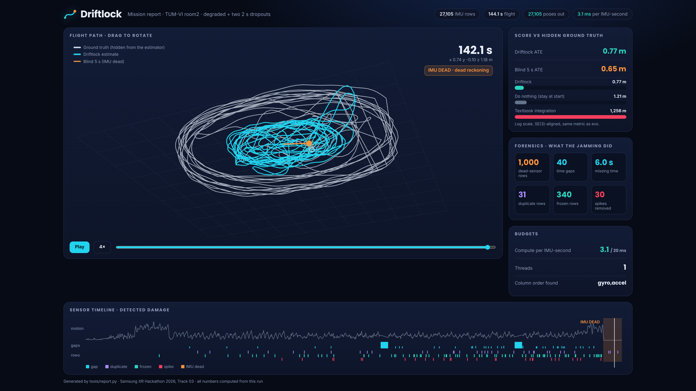

<div align="center">

# Driftlock

### A dying motion sensor in. A trustworthy flight path out.

**Samsung XR Hackathon 2026 · Track 03: Path Finder (Trajectory Estimation Under Sensor Degradation)**

[▶ Demo video (2 min)](docs/Driftlock_demo.mp4) · [Deck (PDF)](docs/Driftlock_Track03.pdf) · [Live mission report (open in browser)](docs/report_sample_tumvi_room2.html) · [All results](results/RESULTS.md)



</div>

## The problem in one breath

An aircraft loses GPS. Jamming corrupts its only motion sensor (the IMU), more and more, then kills it for the last 5 seconds. From that one damaged file we must output where it flew: one 6-DoF pose for every sensor row, in **≤ 8 MB of memory**, **≤ 20 ms of compute per second of data**, on **one CPU thread**.

Do the textbook maths (integrate the sensor twice) on this data and you end up **hundreds of metres to kilometres away** from a path that never left a small room. Driftlock keeps the path bounded, every time.

## Results at a glance

| | Driftlock | "Do nothing" floor* | Textbook integration |
|---|---|---|---|
| TUM-VI handheld (12 degraded runs) | **0.83 m** | 1.07 m | ~700 m |
| EuRoC drone, tuning (9 runs) | **4.31 m** | 4.33 m | ~8 km |
| EuRoC drone, **never tuned on** (9 runs) | **2.61 m** | 2.67 m | ~5.3 km |

| Budget | Limit | Driftlock (EuRoC MH_01, 184 s, 35,629 rows) |
|---|---|---|
| Peak memory (heap, per FAQ) | 8 MB | **5.97 MB** |
| Compute per second of data | 20 ms | **3.1–4.6 ms** across repeated runs (0.6–0.9 s for the whole file) |
| Threads / network | 1 / offline | **1 / none** |
| Poses out | 1 per input row | **35,629 in → 35,629 out** |

\*"Do nothing" keeps every pose at the start point. After the official SE(3) alignment its error equals the size of the real path, so it is the honest floor any estimator should beat. Metrics are ATE RMSE in metres, computed the same way as the `evo` tool the judges use. Our evaluator matches `evo_ape -a` to under a millimetre (4.30771 vs 4.30694 m on MH_01).

**Honest limit.** A motion sensor alone has no absolute position reference. A drone's slow, room-scale drift looks the same to an accelerometer as slow sensor bias, so on EuRoC drone flights Driftlock only slightly beats the floor (1–4%). On handheld motion it beats the floor by 8–39% (22% on average). It **never** blows up, which is where textbook integration loses kilometres.

## How it works

```
 imu0/data.csv ─► 1 Stream parse ─► 2 Forensics ─► 3 Repair ─► 4 Attitude ─► 5 Bounded drift ─► 6 Blind 5 s ─► estimated_trajectory.txt
                  line by line,     dead tail,      interpolate   Mahony filter    true time grid,     decaying         one TUM pose
                  float32           duplicates,     flagged rows, forwards AND     zero-phase FFT      velocity and     per input row
                                    frozen rows,    bridge gaps,  backwards,       high-pass on        turn rate
                                    spikes, gaps,   re-level tilt blended          velocity and
                                    column order    after a gap                    position
```

1. **Forensics first.** We read the organisers' own `degrade_imu.py` and built a detector for every artefact it creates: the all-zero dead tail, dropped rows and 2-second gaps, duplicated rows, frozen ("stuck") rows, and spikes that hit all six channels at once.
2. **We caught a mismatch.** `degrade_imu.py` assumes `accel, gyro` columns, but EuRoC files are `gyro, accel`. Run as-is, it puts the accelerometer noise on the gyroscope (and, on drone data, treats the gyro as m/s²). Driftlock detects the column order and units from the data itself (the accelerometer is the triplet whose length sits at 1 g). We test both cases.
3. **Repair.** Flagged rows are rebuilt by time interpolation. Across a gap we rotate at the mean rate of both sides, and the tilt is re-levelled from gravity as soon as data returns.
4. **Attitude, using the whole flight.** The task is offline (FAQ), so a Mahony filter runs forwards and backwards over the file and the two passes are blended. The accelerometer is trusted only when its magnitude is close to g.
5. **Drift that can't run away.** Gravity-free acceleration is placed on a uniform time grid (so a 2-second dropout stays 2 seconds long). It is integrated to velocity and position, and each step is high-passed with zero phase (FFT, reflect-padded). Bias-driven drift is removed and real motion kept.
6. **Blind 5 seconds.** When the sensor reads exact zeros, Driftlock dead-reckons from the smoothed final state with decaying velocity (τ = 1 s) and turn rate (τ = 0.5 s), tuned on 21 runs.

## Quick start

```bash
pip install numpy
python src/main.py path/to/imu0/data.csv estimated_trajectory.txt --meta metadata.json
```

The input may be a CSV, the evaluation zip, or a folder (`imu0/data.csv` is found automatically). Add `--profile` to print the peak heap.

### The mission report (UI)

```bash
python tools/report.py path/to/imu0/data.csv --gt path/to/groundtruth.csv -o report.html
```

This writes one self-contained HTML page that works offline:
- a 3D flight replay you can drag to rotate and scrub, with the blind 5 s in orange
- the hidden ground truth and the scorecard (Driftlock vs do-nothing vs textbook)
- a forensics timeline of every gap, duplicate, frozen row and spike found

Two examples are in [`docs/`](docs/).

### Docker

```bash
docker build -t driftlock .
docker run --rm -v "$PWD/data:/data" driftlock /data/imu0/data.csv /data/estimated_trajectory.txt
```

## Submission package (Track 3 layout)

`submission_package/` follows the bundle on the Track 3 slide: `estimated_trajectory.txt`, `metadata.json`, `src/main.py`, `src/README.md`. Rebuild or rename it with:

```bash
./make_bundle.sh CollegeName_TeamName                    # zips the bundle
python src/main.py <evaluation imu0/data.csv> estimated_trajectory.txt --meta metadata.json   # for a new file
```

The sample `estimated_trajectory.txt` is EuRoC MH_01_easy degraded with the organisers' script (default settings).

## Reproduce every number

```bash
pip install numpy matplotlib evo
# 1) data: TUM-VI (only IMU + mocap are extracted from the stream)
mkdir -p data && cd data
curl -sL https://cdn2.vision.in.tum.de/tumvi/exported/euroc/512_16/dataset-room1_512_16.tar | tar -x --wildcards '*mav0/imu0/*' '*mav0/mocap0/*'
cd ..
#    EuRoC: place <SEQ>/mav0/imu0/data.csv and <SEQ>/mav0/state_groundtruth_estimate0/data.csv under data/
# 2) degrade each sequence three ways with the official script
python tools/make_test_set.py data/dataset-room1_512_16/mav0/imu0/data.csv test room1 tools/degrade_imu.py
# 3) benchmark against the do-nothing and textbook baselines
python tools/benchmark.py test data --baseline
```

Three variants per sequence: **as-is** (official script on EuRoC column order), **intended** (noise sent to the right sensor), and **intended + two 2-second dropouts**. EuRoC MH_03, V2_01 and V2_02 were held out and never used for tuning.

## Repository map

```
src/main.py                  the estimator (numpy only, single thread, offline)
tools/report.py              mission report UI (self-contained HTML)
tools/evaluate.py            evo-equivalent ATE/RPE + Track 3 tiers (waypoints, blind 5 s, post-dropout)
tools/benchmark.py           runs everything vs baselines
tools/make_test_set.py       builds the three degradation variants
tools/degrade_imu.py         organisers' degradation script (unchanged, for reproducibility)
tools/plot_results.py        static figures
results/                     RESULTS.md, raw JSON, figures
submission_package/          Track 3 bundle layout
docs/                        deck (PDF + PPTX), demo video, sample reports, screenshots
video/                       how the demo video is made (narration, Piper TTS, composed music, ffmpeg)
estimated_trajectory.txt     sample output · metadata.json: runtime, heap, forensics, self-score
AI_DISCLOSURE.md · Dockerfile · requirements.txt · make_bundle.sh
```

## What we tried and dropped

| Idea | Result | Decision |
|---|---|---|
| Rotor-drag velocity (a multirotor's sideways accel ∝ body velocity) | correlation only −0.66 / −0.22 on EuRoC; worse ATE with estimated attitude | dropped |
| 9-state Kalman + RTS smoother | same ATE as the zero-phase filter (1.82 vs 1.84 m), ~10× memory | kept the simpler filter |
| Learned inertial odometry | no room in 8 MB, too few sequences to avoid overfitting | not used |

## Team

Hanniel Vinu A · [github.com/hannielvinu](https://github.com/hannielvinu)

See [`AI_DISCLOSURE.md`](AI_DISCLOSURE.md) for how AI tools were used.
