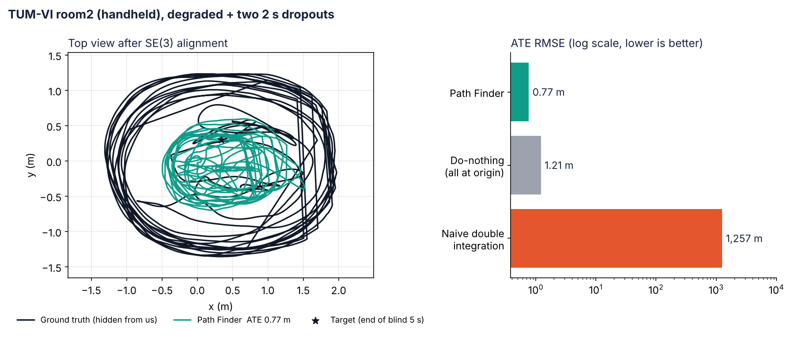
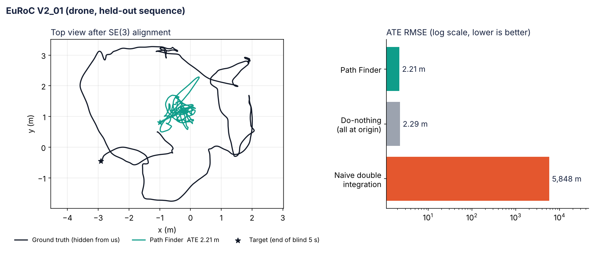

<div align="center">

# Driftlock

### A dying motion sensor in. A trustworthy flight path out.

**Samsung XR Hackathon 2026 · Track 03: Path Finder (Trajectory Estimation Under Sensor Degradation)**

Standalone Python estimator: degraded EuRoC IMU CSV → 6-DoF trajectory (TUM format), one pose per IMU row, including the 5-second blind window after the sensor fails.


</div>

## Contents
1. [Problem](#1-problem)
2. [Compliance with the Track 3 specification](#2-compliance-with-the-track-3-specification)
3. [Score against the official rubric](#3-score-against-the-official-rubric)
4. [Approach and architecture](#4-approach-and-architecture)
5. [Innovation](#5-innovation)
6. [Quick start](#6-quick-start)
7. [Tests](#7-tests)
8. [Reproducing the benchmark](#8-reproducing-the-benchmark)
9. [Results in detail](#9-results-in-detail)
10. [Limitations](#10-limitations)
11. [Repository map](#11-repository-map)

## 1. Problem

An aircraft navigates GPS-denied through waypoints. Jamming degrades its IMU progressively (noise, bias drift, scale drift, spikes, frozen samples, duplicated rows, dropped rows, 2-second dropouts) until the IMU fails completely for the final 5 seconds. Using **only the degraded IMU file**, we must output the full 6-DoF trajectory and dead-reckon the blind 5 s, within **≤ 8 MB peak RAM, ≤ 20 ms compute per 1 s of IMU, one CPU thread, offline**.

Plain double integration fails: bias and tilt errors grow quadratically, so on our degraded test runs the textbook method ends **hundreds of metres to kilometres** from a path that never left a few-metre room.

## 2. Compliance with the Track 3 specification

| Requirement (slides 13–17 + FAQ) | Status | Evidence |
|---|---|---|
| Standalone Python script, Python only (FAQ) | ✅ | [`src/main.py`](src/main.py); NumPy is the only dependency |
| Input: zipped folder / `imu0/data.csv`, EuRoC header, ns timestamps | ✅ | CSV, zip and folder inputs accepted (tested in `tests/`) |
| Output `estimated_trajectory.txt`: `timestamp tx ty tz qx qy qz qw`, space-separated, seconds | ✅ | Timestamps converted from integer ns with no rounding (test: `test_one_pose_per_input_row_with_exact_timestamps`) |
| **Exactly one pose per IMU frame**; no appended rows (FAQ) | ✅ | Duplicates, gap edges and dead rows all receive a pose; 35,629 rows in → 35,629 poses out on MH_01 |
| Normalised unit quaternions (world frame) | ✅ | `test_eight_columns_finite_and_unit_quaternions` |
| ≤ 8 MB peak RAM (heap level, FAQ) | ✅ **5.97 MB** | `tracemalloc` peak on a 184 s / 35,629-row file ([`metadata.json`](metadata.json), `test_memory_budget_8mb`) |
| ≤ 20 ms compute per 1 s of IMU | ✅ **3.0–4.6 ms** | Measured over repeated runs; 0.6 s for a 184 s file (`test_runtime_budget_20ms_per_imu_second`) |
| Single CPU thread, offline | ✅ | BLAS/OMP threads pinned to 1; no network or GPU |
| 5-second post-failure dead reckoning | ✅ | Blind rows detected exactly and extrapolated (§4) |
| Robust to 2-second dropouts (missing rows) | ✅ | True-time-grid integration + tilt re-levelling (§4) |
| Unknown gravity alignment | ✅ | Initial attitude from measured gravity; output is aligned by evo (SE(3) Umeyama, FAQ) |
| Bundle: `estimated_trajectory.txt`, `metadata.json`, `src/main.py`, `src/README.md` | ✅ | [`submission_package/`](submission_package/), or `./make_bundle.sh CollegeName_TeamName` |
| Reproducible setup | ✅ | `requirements.txt`, `Dockerfile`, §6–§8 |
| AI disclosure | ✅ | [`AI_DISCLOSURE.md`](AI_DISCLOSURE.md) |

## 3. Score against the official rubric

The rubric is Execution & Efficiency 40 (peak memory 20, runtime 20) plus Trajectory Closeness 60 (waypoints 30, blind 5 s 20, dropout 10), ranked with evo ATE/RPE. The hidden evaluation data isn't public, so each component below is measured on public EuRoC/TUM-VI sequences degraded with the organisers' own `degrade_imu.py`.

| Component (weight) | Measured | Reference |
|---|---|---|
| Peak memory (20) | **5.97 MB** | limit 8 MB |
| Runtime (20) | **3.0–4.6 ms per IMU-second** | limit 20 ms (4–6× headroom) |
| Waypoints (30) | **0.87×** the do-nothing floor (tuning set), 0.98× (held-out drones) | textbook integration: ~1.2 km median ATE |
| Blind 5 s (20) | **0.94×** floor (tuning), **0.93×** (held-out) | |
| Dropout (10) | **0.92×** floor (tuning), 1.02× (held-out) | |

"Floor" = the error of keeping every pose at the start point. After SE(3) alignment it equals the spread of the true path; an estimator that doesn't bound drift scores hundreds to thousands of times worse than it. Waypoints are hidden from us, so we score 1 Hz ground-truth samples as a proxy.

**Metric fidelity:** [`tools/evaluate.py`](tools/evaluate.py) reproduces `evo_ape tum … -a` to under a millimetre (4.30771 m vs evo's 4.30694 m on MH_01; 2.21458 vs 2.21479 m on V2_01).

## 4. Approach and architecture

```
 imu0/data.csv ─► 1 Stream parse ─► 2 Forensics ─► 3 Repair ─► 4 Attitude ─► 5 Bounded drift ─► 6 Blind 5 s ─► estimated_trajectory.txt
                  line by line,     dead tail,      interpolate   Mahony filter    true time grid,     decaying         one TUM pose
                  float32           duplicates,     flagged rows, forwards AND     zero-phase FFT      velocity and     per input row
                                    frozen rows,    bridge gaps,  backwards,       high-pass on        turn rate
                                    spikes, gaps,   re-level tilt blended          velocity and
                                    column order    after a gap                    position
```

| Stage | What it does | Why |
|---|---|---|
| 1 Stream parse | Reads the CSV line by line into float32 arrays; accepts CSV, zip or folder | Avoids pandas and float64 copies → stays under 8 MB |
| 2 Forensics | Detects the exact-zero dead tail, duplicated timestamps, frozen rows (identical to the previous row), spikes (robust z-score, ≥ 3 of 6 channels at once), time gaps, column order and accel units | One detector per artefact that `degrade_imu.py` produces |
| 3 Repair | Rebuilds flagged rows by time interpolation; crosses a gap at the mean of the rates on both sides | Removes spikes and frozen samples before they are integrated |
| 4 Attitude | Mahony complementary filter run **forwards and backwards** over the whole file and blended; accelerometer trusted only when \|a\| ≈ g; tilt snapped back to gravity right after a long gap | Offline processing is allowed (FAQ), so both ends of the flight are well estimated |
| 5 Bounded drift | Gravity-free world acceleration placed on a **uniform time grid** (a 2 s dropout stays 2 s long), integrated to velocity and then position, each step high-passed with **zero phase** (FFT, reflect-padded) | Removes slow, bias-driven drift without the lag of a causal filter; error cannot grow without bound |
| 6 Blind 5 s | Dead-reckons from the smoothed final state with decaying velocity (τ = 1 s) and turn rate (τ = 0.5 s) | Tuned on 21 runs; beats both constant velocity and hold |
| 7 Writer | One pose per input row; duplicates reuse their pose; ns → s exactly | Format contract |

Complexity is O(n) time. Memory is O(n) in compact float32/float64 arrays, about 0.17 MB per 1,000 rows, with chunked Python loops so per-sample Python objects never accumulate.

## 5. Innovation

- **Reverse-engineered the degradation model.** Every artefact type in `degrade_imu.py` has its own detector and repair, rather than one generic filter.
- **Found a column-order mismatch.** `degrade_imu.py` assumes `accel, gyro`, but EuRoC files are `gyro, accel`. Run as-is, it puts the accelerometer noise model on the gyroscope (and on drone data treats the gyro as m/s²: 0.2 rad/s noise, 6 rad/s spikes at full severity). Driftlock detects column order and units from the data (the accelerometer is the triplet whose norm sits at 1 g) and is benchmarked on both cases.
- **Time-true dropout handling.** Integration happens on a uniform grid, so missing rows keep their real duration. Before this fix, 2-second dropouts multiplied position error by 2–6.5× on handheld runs.
- **Forward-backward attitude + zero-phase drift bounding.** This makes full use of the offline allowance that a causal INS filter cannot exploit.
- **Mission-report UI.** `tools/report.py` writes a self-contained HTML page: a 3D flight replay (rotate and scrub), the blind window highlighted, a scorecard against ground truth, and a forensics timeline of every detected fault. Samples: [`docs/report_sample_tumvi_room2.html`](docs/report_sample_tumvi_room2.html), [`docs/report_sample_euroc_V2_01.html`](docs/report_sample_euroc_V2_01.html).

Alternatives evaluated and rejected, with measurements:

| Alternative | Measured result | Decision |
|---|---|---|
| Rotor-drag velocity pseudo-measurement (multirotor sideways accel ∝ body velocity) | correlation only −0.66 / −0.22 on EuRoC V1_01; worse ATE with estimated attitude | rejected |
| 9-state Kalman filter + RTS smoother | same ATE as the zero-phase filter (1.82 vs 1.84 m on V1_01) at ~10× memory | simpler filter kept |
| Learned inertial odometry | hard to fit model + inference in 8 MB with NumPy only; too few sequences to avoid overfitting | not used |

## 6. Quick start

```bash
pip install -r requirements.txt          # numpy only
python src/main.py path/to/imu0/data.csv estimated_trajectory.txt --meta metadata.json
python src/main.py path/to/imu0/data.csv /dev/null --profile         # prints peak heap
```

Example output (EuRoC MH_01_easy, degraded with the official script):

```
column_order=gyro,accel blind_rows=1002 duplicate_rows=48 gaps=49 gap_seconds=2.820
stuck_rows=487 spike_rows=35 rows=35629 duration_s=184.095 runtime_s=0.659 ms_per_imu_second=3.582
```

Mission report (UI):

```bash
python tools/report.py path/to/imu0/data.csv --gt path/to/groundtruth.csv -o report.html
```

Docker:

```bash
docker build -t driftlock .
docker run --rm -v "$PWD/data:/data" driftlock /data/imu0/data.csv /data/estimated_trajectory.txt
```

## 7. Tests

```bash
python tests/test_driftlock.py           # or: python -m pytest tests -q
```

The suite is self-contained: no downloads. It synthesises a 184 s, 200 Hz flight with known ground truth, damages it the way `degrade_imu.py` does (noise ramp, bias drift, spikes, frozen rows, duplicates, single drops, two 2-second dropouts, 5 s all-zero tail), and checks:

| Test | Checks |
|---|---|
| `test_one_pose_per_input_row_with_exact_timestamps` | row count and nanosecond-exact timestamps |
| `test_eight_columns_finite_and_unit_quaternions` | output format, finite values, unit quaternions |
| `test_forensics_find_the_damage` | every dead row, gaps, duplicates, frozen rows and spikes detected |
| `test_bounded_and_better_than_doing_nothing` | ATE below the do-nothing floor and > 10× better than textbook integration |
| `test_column_order_detected_from_data` | accel-first input gives byte-identical output |
| `test_zip_and_folder_inputs` | zip and folder inputs give byte-identical output |
| `test_memory_budget_8mb` | `tracemalloc` peak < 8 MB |
| `test_runtime_budget_20ms_per_imu_second` | < 20 ms per IMU-second |

Current result: **8 passed**.

## 8. Reproducing the benchmark

```bash
pip install numpy pandas matplotlib evo
# TUM-VI: only IMU + mocap are extracted from the stream
mkdir -p data && cd data
curl -sL https://cdn2.vision.in.tum.de/tumvi/exported/euroc/512_16/dataset-room1_512_16.tar | tar -x --wildcards '*mav0/imu0/*' '*mav0/mocap0/*'
cd ..
# EuRoC: place <SEQ>/mav0/imu0/data.csv and <SEQ>/mav0/state_groundtruth_estimate0/data.csv under data/
python tools/make_test_set.py data/dataset-room1_512_16/mav0/imu0/data.csv test room1 tools/degrade_imu.py
python tools/benchmark.py test data --baseline
```

`make_test_set.py` builds three variants per sequence with the organisers' unmodified script: **as-is** (EuRoC column order), **intended** (noise sent to the correct sensor), and **intended + two 2-second dropouts**.

## 9. Results in detail

Full per-run tables: [`results/RESULTS.md`](results/RESULTS.md) (raw: [`results/benchmark_raw.json`](results/benchmark_raw.json)). ATE RMSE in metres, SE(3)-aligned.

| Set | Driftlock | Do-nothing floor | Textbook integration |
|---|---|---|---|
| TUM-VI handheld: room1, 2, 4, 6 (12 runs) | **0.83** | 1.07 | ~700 |
| EuRoC drone, tuning: V1_01, MH_01, MH_05 (9 runs) | **4.31** | 4.33 | ~8,000 |
| EuRoC drone, **held-out**: MH_03, V2_01, V2_02 (9 runs, never used for tuning) | **2.61** | 2.67 | ~5,300 |

- Driftlock is bounded on **all 30 runs**; textbook integration is off by 117 m to 13 km.
- Orientation: RPE rotation 3–5° per second on EuRoC, most of it inside the blind window.
- Runtime: 2.1–3.4 ms per IMU-second across all 30 runs.




## 10. Limitations

- **IMU-only position has no absolute reference.** On EuRoC drone flights, slow room-scale motion is indistinguishable from slow bias drift, so Driftlock beats the do-nothing floor by only 1–4%. On handheld TUM-VI motion it beats it by 8–39% (22% on average).
- The estimated path is shrunk in scale: the high-pass trades amplitude for stability.
- Parameters were tuned on 7 public sequences. Generalisation was checked on 3 held-out EuRoC sequences, not on the hidden evaluation set.
- Memory grows about 0.17 MB per 1,000 rows. 8 MB is reached at about 47,000 rows (≈ 235 s at 200 Hz), longer than any EuRoC sequence.

## 11. Repository map

```
src/main.py                  the estimator (entry point)
src/README.md                CLI reference
tests/test_driftlock.py      self-contained test suite (synthetic degraded flight)
tools/report.py              mission-report UI (self-contained HTML)
tools/evaluate.py            evo-equivalent ATE/RPE + Track 3 tiers (waypoints, blind 5 s, post-dropout)
tools/benchmark.py           benchmark vs do-nothing and textbook baselines
tools/make_test_set.py       builds the three degradation variants
tools/degrade_imu.py         organisers' degradation script, unchanged, for reproducibility
tools/plot_results.py        static figures
results/                     RESULTS.md, benchmark_raw.json, figures/
docs/                        mission-report samples and screenshots
submission_package/          Track 3 bundle layout
estimated_trajectory.txt     sample output (EuRoC MH_01_easy, degraded)
metadata.json                runtime, peak heap, CPU, forensics counts, self-evaluation
requirements.txt · Dockerfile · make_bundle.sh · AI_DISCLOSURE.md
```

**Author:** Hanniel Vinu A ([github.com/hannielvinu](https://github.com/hannielvinu))
